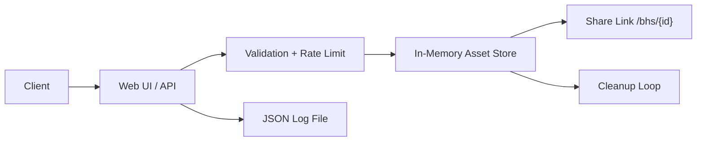

# Black Hole Share

<p align="center">
  
</p>

Black Hole Share is a lightweight temporary sharing service built with Rust and Actix Web. It accepts images or plain text, keeps them in memory for a short time, and exposes each upload through a unique URL until the item expires.

## Features

- Web UI for drag and drop, clipboard paste, click-to-upload, and text sharing
- Temporary links with a configurable lifetime from 1 to 60 minutes
- Automatic cleanup of expired assets
- Simple JSON API for uploads, content retrieval, and live statistics
- In-memory storage with no database dependency
- Per-IP upload limiting based on active, not-yet-expired uploads
- Reverse proxy support through an explicit list of trusted proxies
- Upload type allowlist, sandboxed content delivery, and security headers on every response
- Request and lifecycle logging with automatic rotation and bounded retention
- Stats page showing active assets, storage usage, and recent activity

## Block Diagram

See [docs/block-diagram.md](./docs/block-diagram.md) for the standalone rendered diagram.

## How It Works

1. A client uploads plain text or an image through the web UI or `POST /api/upload`.
2. The server stores the asset in memory and assigns a UUID-based share link.
3. The asset remains available until its TTL expires.
4. A background cleanup task runs every second and removes expired assets.
5. Uploads, deletions, and HTTP requests are written to the log file.



## Runtime Characteristics

- Assets are stored only in memory.
- Uploaded content is lost when the process stops or restarts.
- Static web files and logs are read from `data/`.
- `data/logs/` is created at startup if it is missing.
- Logs are rotated on startup and whenever `log.txt` reaches 50 MB.

## Limits

| Item | Value |
| --- | --- |
| Asset TTL | 1 to 60 minutes |
| Max decoded asset size | 3 MB |
| Max in-memory assets | 1000 |
| Max total in-memory size | 512 MB |
| Max active uploads per IP | 10 |

The per-IP limit is released as that client's shared items expire. Image uploads are sent as base64 in JSON, so the HTTP request body may be larger than the decoded asset.

## Project Layout

| Path | Purpose |
| --- | --- |
| `src/main.rs` | Server bootstrap, routes, static file handling |
| `src/api.rs` | Upload, content, and stats API |
| `src/data_mgt.rs` | In-memory asset store, cleanup, rate limiting |
| `src/logs.rs` | JSON line logging, log rotation, and in-memory stats counters |
| `src/tests.rs` | Automated tests |
| `data/html/` | Static frontend pages and web assets |
| `data/logs/` | Runtime log output |

## Run Locally

Requirements:

- Rust toolchain
- The `data/html/` directory from this repository
- Write access to `data/`, used for `data/logs/`

Start the server:

```bash
cargo run --release
```

Default bind address and port:

- Address: `0.0.0.0`
- Port: `8080`

Then open:

- `http://127.0.0.1:8080/`

## Run With Docker Compose

`docker compose` is the recommended container workflow because the application expects the repository `data/` directory to be mounted.

```bash
docker compose up --build
```

Current compose settings:

- Container bind: `0.0.0.0:8080`
- Host port: `8080`
- Data mount: `./data:/data`
- Container user: UID `1000`, so `./data` must be writable by that UID

With rootless Podman, add `userns_mode: keep-id` to the service so that UID `1000` maps to your host user. Rootless Podman also cannot bind port 80 as a non-root user, which is why the container listens on `8080`.

Then open:

- `http://127.0.0.1:8080/`

## Configuration

| Environment Variable | Default | Description |
| --- | --- | --- |
| `BIND_ADDR` | `0.0.0.0` | Address the HTTP server binds to |
| `BIND_PORT` | `8080` | Port the HTTP server binds to |
| `TRUSTED_PROXIES` | empty | Comma-separated proxy IPs allowed to report the client address via `X-Forwarded-For` |

## Reverse Proxy

Behind a reverse proxy, set `TRUSTED_PROXIES` to the proxy IP. Separate multiple proxies with commas. CIDR ranges are not supported, so give the proxy a fixed IP.

```yaml
environment:
  - TRUSTED_PROXIES=10.89.77.2
```

The client address used for upload limits and logs is resolved as follows:

| Request comes from | Address used |
| --- | --- |
| A proxy in `TRUSTED_PROXIES` | The last untrusted entry in `X-Forwarded-For`, or the proxy IP if there is none |
| Any other peer | The connection IP; forwarding headers are ignored |

Without `TRUSTED_PROXIES`, every client appears to come from the proxy and all of them share one upload limit.

Do not enable an option that makes the proxy trust incoming forwarding headers, such as `forwardedHeaders.trustedIPs` in Traefik or `trusted_proxies` in Caddy, unless another proxy sits in front of it.

Traefik labels:

```yaml
labels:
  - "traefik.enable=true"
  - "traefik.http.routers.bhs.rule=Host(`bhs.example.com`)"
  - "traefik.http.services.bhs.loadbalancer.server.port=8080"
```

Caddyfile:

```text
bhs.example.com {
    reverse_proxy bhs:8080
}
```

## Web Endpoints

| Method | Path | Description |
| --- | --- | --- |
| `GET` | `/` | Upload page |
| `GET` | `/bhs/{id}` | View a shared asset |
| `GET` | `/stats` | Statistics dashboard |

Unknown paths return the error page with status `404`.

## API

### Upload

`POST /api/upload`

Request body:

```json
{
  "duration": 5,
  "content_type": "text/plain",
  "content": "hello world"
}
```

For images, `content` must be a base64-encoded payload string and `content_type` must be one of `image/png`, `image/jpeg`, `image/gif`, `image/webp`, `image/avif`, or `image/bmp`. The only accepted text type is `text/plain`. SVG and HTML are rejected because they can run scripts.

Successful response:

```json
{
  "link": "/bhs/550e8400-e29b-41d4-a716-446655440000"
}
```

Possible error responses include:

- `400 Bad Request` for invalid base64 input
- `413 Payload Too Large` for assets above 3 MB
- `415 Unsupported Media Type` for a `content_type` that is not allowed
- `429 Too Many Requests` when the active upload limit is exceeded
- `503 Service Unavailable` when the in-memory storage is full

The requested duration is clamped to the supported range of `1..=60` minutes.

### Fetch Shared Content

`GET /api/content/{id}`

Returns the raw content with the stored MIME type and a sandbox `Content-Security-Policy`, or `404` if the asset has expired or does not exist.

### Stats

`GET /api/stats`

Returns counters and recent activity kept in memory since the last startup, including:

- active assets
- total uploads
- total deleted
- storage bytes
- image count
- text count
- total requests
- recent upload and delete events

## Logging

Logs are written as JSON lines to:

```text
data/logs/log.txt
```

Logged event types:

- HTTP requests
- asset uploads
- asset deletions
- error events

On startup, an existing log file is renamed with a UTC timestamp before a new `log.txt` is created. The same rotation happens while running when `log.txt` reaches 50 MB. Only the 10 most recent rotated logs are kept; older ones are deleted.

## Notes

- This service is designed for short-lived sharing, not durable storage.
- There is currently no persistent asset backend and no authentication layer.
- The repository includes frontend assets under `data/html/`; if those files are missing, the web UI will not render correctly.

## Development

Run the automated tests from the project root:

```bash
cargo test
```
