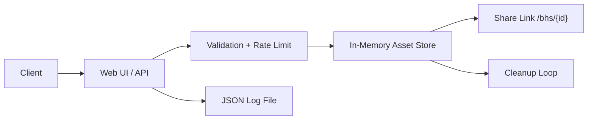

# Black Hole Share

<p align="center">
  
</p>

Black Hole Share is a lightweight temporary sharing service built with Rust and Actix Web. It accepts images or plain text, keeps them in memory for a short time, and exposes each upload through a unique URL until the item expires.

## Features

- Web UI for drag and drop, clipboard paste, click-to-upload, and text sharing
- Temporary links with a configurable lifetime, 1 to 60 minutes by default
- Automatic cleanup of expired assets
- Simple JSON API for uploads, content retrieval, and live statistics
- In-memory storage with no database dependency
- Per-IP upload limiting based on active, not-yet-expired uploads
- Reverse proxy support through an explicit list of trusted proxies
- Upload type allowlist, sandboxed content delivery, and security headers on every response
- Request and lifecycle logging with automatic rotation and bounded retention
- Stats page showing active assets, storage usage, and recent activity
- Admin panel to manage assets and change limits and server settings without editing files
- File sharing for the admin: any file type, stored on disk, with an expiry, an optional download limit, and an optional opening time
- Admin control panel at `/admin` to list and delete active assets and see uploads per IP

## Block Diagram

See [docs/block-diagram.md](./docs/block-diagram.md) for the standalone rendered diagram.

## How It Works

1. A client uploads plain text or an image through the web UI or `POST /api/upload`.
2. The server stores the asset in memory and assigns a UUID-based share link.
3. The asset remains available until its TTL expires.
4. A background cleanup task runs every second and removes expired assets.
5. Uploads, deletions, and HTTP requests are written to the log file.



## Runtime Characteristics

- Public assets (text and images) are stored only in memory and are lost when the process stops or restarts.
- Files shared by the admin are stored on disk in `data/storage/` and survive restarts until they expire.
- Static web files and logs are read from `data/`.
- `data/logs/` is created at startup if it is missing.
- Logs are rotated on startup and whenever `log.txt` reaches the configured size (50 MiB by default).
- Admin credentials, the session key, and the settings are stored in `data/admin/` and survive restarts.

## Limits

Defaults; all of them can be changed in the admin panel (see [Configuration](#configuration)).

| Item | Default |
| --- | --- |
| Asset TTL | 1 to 60 minutes |
| Max decoded asset size | 3 MiB |
| Max in-memory assets | 1000 |
| Max total in-memory size | 512 MiB |
| Max active uploads per IP | 10 |

The per-IP limit is released as that client's shared items expire. Image uploads are sent as base64 in JSON, so the HTTP request body may be larger than the decoded asset; the server accepts a body of up to twice the asset size limit plus 1 KiB.

## Project Layout

| Path | Purpose |
| --- | --- |
| `src/main.rs` | Server bootstrap, routes, static file handling |
| `src/api.rs` | Upload, content, and stats API |
| `src/data_mgt.rs` | In-memory asset store, cleanup, rate limiting |
| `src/logs.rs` | JSON line logging, log rotation, and in-memory stats counters |
| `src/admin.rs` | Admin panel API and session handling |
| `src/auth.rs` | Admin credentials (Argon2id hash) and session key storage |
| `src/settings.rs` | Runtime settings: defaults, validation, `settings.json` storage |
| `src/files.rs` | Shared files on disk: upload, download counting, expiry, startup reconciliation |
| `src/tests.rs` | Automated tests |
| `data/html/` | Static frontend pages and web assets |
| `data/logs/` | Runtime log output |
| `data/admin/` | Admin credentials, session key, and settings, created at runtime, never commit it |
| `data/storage/` | Files shared by the admin (`<uuid>`) and their index (`index.json`), created at runtime |

## Run Locally

Requirements:

- Rust toolchain
- The `data/html/` directory from this repository
- Write access to `data/`, used for `data/logs/`

Start the server:

```bash
cargo run --release
```

Default bind address and port, changeable in the admin panel:

- Address: `0.0.0.0`
- Port: `8080`

Then open:

- `http://127.0.0.1:8080/`

## Run With Docker Compose

`docker compose` is the recommended container workflow because the application expects the repository `data/` directory to be mounted.

```bash
docker compose up --build
```

Current compose settings:

- Container bind: `0.0.0.0:8080`
- Host port: `8080`
- Data mount: `./data:/data`
- Container user: UID `1000`, so `./data` must be writable by that UID

With rootless Podman, add `userns_mode: keep-id` to the service so that UID `1000` maps to your host user. Rootless Podman also cannot bind port 80 as a non-root user, which is why the container listens on `8080`.

Then open:

- `http://127.0.0.1:8080/`

## Configuration

Settings live in `data/admin/settings.json` and are edited in the **Settings** section of the admin panel. The file is created with the defaults on first start. A file that cannot be parsed, has an unknown field, or holds a value outside the allowed range stops startup and names the problem; a missing field takes its default.

| Setting | Default | Allowed | Applies |
| --- | --- | --- | --- |
| `min_asset_duration_minutes` | `1` | 1 or more, not above the maximum | immediately |
| `max_asset_duration_minutes` | `60` | up to 1440 | immediately |
| `max_assets` | `1000` | 1 to 100000 | immediately |
| `max_asset_size_bytes` | `3145728` (3 MiB) | 1 to 104857600 (100 MiB) | immediately |
| `max_total_storage_bytes` | `536870912` (512 MiB) | not below `max_asset_size_bytes` | immediately |
| `max_uploads_per_ip` | `10` | 1 to 10000 | immediately |
| `max_file_size_bytes` | `1073741824` (1 GiB) | 1 to 107374182400 (100 GiB) | next file upload |
| `max_files_total_bytes` | `10737418240` (10 GiB) | not below `max_file_size_bytes` | next file upload |
| `max_file_duration_minutes` | `10080` (7 days) | 1 to 525600 (365 days) | next file upload |
| `max_log_file_bytes` | `52428800` (50 MiB) | at least 1048576 (1 MiB) | next write |
| `max_rotated_logs` | `10` | 0 to 1000 | next rotation |
| `max_recent_activity` | `20` | 1 to 1000 | immediately |
| `trusted_proxies` | `[]` | up to 64 IP addresses | immediately |
| `admin_session_max_age_minutes` | `480` | 5 to 10080 | after restart |
| `bind_addr` | `0.0.0.0` | an IP address | after restart |
| `bind_port` | `8080` | 1 to 65535 | after restart |

When the server runs in a container, changing `bind_addr` or `bind_port` also needs a matching port mapping, or the server is unreachable after the restart.

One environment variable is still read:

| Environment Variable | Default | Description |
| --- | --- | --- |
| `ADMIN_COOKIE_SECURE` | `true` | `false` lets the admin session cookie work over plain HTTP; any other value stops startup |

`BIND_ADDR`, `BIND_PORT`, and `TRUSTED_PROXIES` are no longer read; the server prints a warning if they are set.

## Reverse Proxy

Behind a reverse proxy, add the proxy IP to **Trusted proxies** in the admin panel (`trusted_proxies` in `settings.json`). Separate multiple proxies with commas. CIDR ranges are not supported, so give the proxy a fixed IP.

```json
"trusted_proxies": ["10.89.77.2"]
```

The client address used for upload limits and logs is resolved as follows:

| Request comes from | Address used |
| --- | --- |
| A proxy in `trusted_proxies` | The last untrusted entry in `X-Forwarded-For`, or the proxy IP if there is none |
| Any other peer | The connection IP; forwarding headers are ignored |

Without `trusted_proxies`, every client appears to come from the proxy and all of them share one upload limit.

Do not enable an option that makes the proxy trust incoming forwarding headers, such as `forwardedHeaders.trustedIPs` in Traefik or `trusted_proxies` in Caddy, unless another proxy sits in front of it.

Traefik labels:

```yaml
labels:
  - "traefik.enable=true"
  - "traefik.http.routers.bhs.rule=Host(`bhs.example.com`)"
  - "traefik.http.services.bhs.loadbalancer.server.port=8080"
```

Caddyfile:

```text
bhs.example.com {
    reverse_proxy bhs:8080
}
```

## Web Endpoints

| Method | Path | Description |
| --- | --- | --- |
| `GET` | `/` | Upload page |
| `GET` | `/bhs/{id}` | View a shared asset |
| `GET` | `/stats` | Statistics dashboard |
| `GET` | `/admin` | Admin control panel (login required) |
| `GET` | `/f/{id}` | Download page of a shared file |

Unknown paths return the error page with status `404`.

## API

### Upload

`POST /api/upload`

Request body:

```json
{
  "duration": 5,
  "content_type": "text/plain",
  "content": "hello world"
}
```

For images, `content` must be a base64-encoded payload string and `content_type` must be one of `image/png`, `image/jpeg`, `image/gif`, `image/webp`, `image/avif`, or `image/bmp`. The only accepted text type is `text/plain`. SVG and HTML are rejected because they can run scripts.

Successful response:

```json
{
  "link": "/bhs/550e8400-e29b-41d4-a716-446655440000"
}
```

Possible error responses include:

- `400 Bad Request` for invalid JSON or invalid base64 input
- `413 Payload Too Large` for assets above `max_asset_size_bytes`
- `415 Unsupported Media Type` for a body that is not `application/json`, or a `content_type` that is not allowed
- `429 Too Many Requests` when the active upload limit is exceeded
- `503 Service Unavailable` when the in-memory storage is full

The requested duration is clamped to the configured range, `1..=60` minutes by default.

### Limits

`GET /api/limits`

Returns the current upload limits, which the upload page uses for its duration slider:

```json
{
  "min_duration_minutes": 1,
  "max_duration_minutes": 60,
  "max_asset_size_bytes": 3145728
}
```

### Fetch Shared Content

`GET /api/content/{id}`

Returns the raw content with the stored MIME type and a sandbox `Content-Security-Policy`. Returns `400` if `{id}` is not a valid UUID, or `404` if the asset has expired or does not exist.

### Shared Files

`GET /api/files/{id}/info`

Public details of a shared file: `name`, `size`, `expires_at`, `valid_from` (or `null`), `available`, and `downloads_left` (or `null` when unlimited). Times are Unix milliseconds. Returns `404` when the file does not exist, has expired, or reached its download limit.

`GET /api/files/{id}`

Sends the whole file as `application/octet-stream` with `Content-Disposition: attachment` and a sandbox `Content-Security-Policy`, so a browser always saves it and never renders it.

- Every request is one counted download. `Range` requests are not supported on purpose: a download limit could otherwise be bypassed by fetching the file in pieces, so an interrupted download restarts from the beginning.
- When the last allowed download starts, the file is deleted; that download still completes.
- `403` with `valid_from` before the opening time, `404` as above, `400` for an invalid id.

### Stats

`GET /api/stats`

Returns counters and recent activity kept in memory since the last startup, including:

- active assets
- total uploads
- total deleted
- storage bytes
- image count
- text count
- total requests
- recent upload and delete events

## Logging

Logs are written as JSON lines to:

```text
data/logs/log.txt
```

Logged event types:

- HTTP requests
- asset uploads
- asset deletions
- error events
- admin actions: setup, login, failed login, logout, password change, asset deletion, settings change (with the old and new value of each changed field), file upload and deletion
- shared file events: download (with the client IP and the download count) and expiry

On startup, an existing log file is renamed with a UTC timestamp before a new `log.txt` is created. The same rotation happens while running when `log.txt` reaches `max_log_file_bytes` (50 MiB by default). Only the `max_rotated_logs` most recent rotated logs are kept (10 by default); older ones are deleted.

## Admin Panel

Open `/admin`. Uploading, viewing, and the public stats stay open to everyone; only the panel requires a login.

### First login

While no admin account exists, `/admin` shows a form that creates it, and the server prints `Admin credentials not set` at startup. **Whoever opens `/admin` first becomes the admin**, so create the account right after the first start, before exposing the service.

There is a single admin account. Its credentials are stored in `data/admin/credentials.json` (username and an Argon2id password hash, file mode `0600`). To reset them, stop the server, delete that file, and start again: the setup form appears again. A credentials file that cannot be read stops startup instead of reopening the setup.

### Sessions

- Login sets the `bhs_admin` cookie: encrypted with the key in `data/admin/session.key`, `HttpOnly`, `SameSite=Strict`, limited to `/api/admin`, and `Secure` unless `ADMIN_COOKIE_SECURE=false`.
- A session lasts at most `admin_session_max_age_minutes` (8 hours by default).
- Logging out or changing the password ends every admin session, on every device.
- Browsers accept `Secure` cookies on `http://localhost` and `http://127.0.0.1`. For any other plain-HTTP address the login cannot work unless you set `ADMIN_COOKIE_SECURE=false`; prefer HTTPS through a reverse proxy instead.

### Features

- Usage cards: active assets, storage, totals since startup
- Active uploads grouped by uploader IP
- Active assets with type, size, uploader IP, and time left, with early deletion (the uploader's slot in the per-IP limit is freed)
- Tabs: **Overview** (usage, uploads by IP, active assets), **Files**, **Settings**, **Account** (password); the tab is kept in the URL (`/admin#files`)
- Files: drag and drop or pick a file, set its name, how long it stays available, an optional download limit, and an optional opening time; upload with progress and cancel; list with downloads, status, copy link, and delete
- Settings: one section per type (public uploads, files, logs, network, admin session), each saved on its own, with per-field errors, a "Restore defaults" button, and a notice when a restart is needed
- Password change

### Admin API

All routes are under `/api/admin`, take and return JSON, and are never cached.

| Method | Path | Login | Description |
| --- | --- | --- | --- |
| `GET` | `/status` | no | `configured`, `authenticated`, `username` |
| `POST` | `/setup` | no | `{ "username", "password" }`; only while no account exists, otherwise `409` |
| `POST` | `/login` | no | `{ "username", "password" }`; `401` on wrong credentials |
| `POST` | `/logout` | yes | Ends every admin session |
| `POST` | `/password` | yes | `{ "current_password", "new_password" }`; `403` if the current password is wrong |
| `GET` | `/assets` | yes | Active assets |
| `DELETE` | `/assets/{id}` | yes | Delete an asset now; `204`, `400` for an invalid id, `404` if missing |
| `GET` | `/stats` | yes | Usage, limits, and active uploads per IP |
| `GET` | `/settings` | yes | `current` (saved), `running` (in use since startup), and `defaults` settings, `restart_fields`, and `restart_pending` |
| `POST` | `/files?name=&duration_minutes=&max_downloads=&valid_from=` | yes | Raw file bytes as the body, `Content-Length` required (`411` without it). `duration_minutes` counts from `valid_from` (Unix ms) when given. `201` with the file and its `link`; `400` invalid input or a body that does not match its length, `413` over `max_file_size_bytes`, `507` over `max_files_total_bytes` |
| `GET` | `/files` | yes | Shared files that have not expired, with downloads and `link` |
| `DELETE` | `/files/{id}` | yes | Delete a shared file now; `204`, `400` for an invalid id, `404` if missing |
| `PUT` | `/settings` | yes | Every setting, all fields required; `400` with `fields: [{ field, message }]` when invalid. Saves and applies them, and returns the same body as `GET` |

Usernames are 1 to 64 characters without control characters or surrounding spaces; passwords are 8 to 256 characters. Routes that need a login return `401` without a valid session.

## Notes

- This service is designed for short-lived sharing, not durable storage.
- There is currently no persistent asset backend.
- Failed admin logins are logged but not rate limited.
- The repository includes frontend assets under `data/html/`; if those files are missing, the web UI will not render correctly.

## Development

Run the automated tests from the project root:

```bash
cargo test
```
