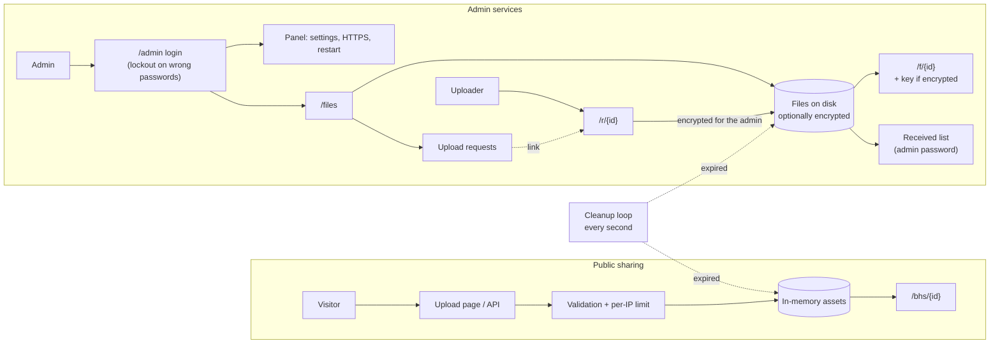

# Architecture and Operations

[README](../README.md) · [Configuration](configuration.md) · [Admin](admin.md) · [API](api.md) · [Architecture](architecture.md)

The full component diagram is in [block-diagram.md](block-diagram.md).

## How It Works

Public sharing, open to everyone:

1. A client uploads plain text or an image through the web UI or `POST /api/upload`.
2. The server stores the asset in memory and assigns a UUID-based share link (`/bhs/{id}`).
3. The asset remains available until its TTL expires; a background task removes expired assets every second.

Admin services, behind the login at `/admin`:

1. The admin manages the server from the panel: usage, active assets, every setting, HTTPS, and a restart.
2. On `/files` the admin shares files from disk through `/f/{id}`, optionally encrypted with a key sent separately.
3. The admin creates upload requests (`/r/{id}`): anyone with the link can send files, which arrive encrypted in the admin's **Received** list.

Every request and admin action is written to the log file and to standard output.



## Runtime Characteristics

- Public assets (text and images) are stored only in memory and are lost when the process stops or restarts.
- Files shared by the admin are stored on disk in `data/storage/` and survive restarts until they expire.
- Static web files and logs are read from `data/`.
- `data/logs/` is created at startup if it is missing.
- Logs are rotated on startup and whenever `log.txt` reaches the configured size (50 MiB by default).
- Admin credentials, the session key, the settings, and the self-signed certificate are stored in `data/admin/` and survive restarts.
- Every log event is also printed to standard output.
- **Back up `data/`**: losing `data/admin/credentials.json` makes encrypted files that were received through upload requests unreadable for good.

## Logging

Every log event is written to the log file and, as the same JSON line, to standard output, so `docker logs` and `podman logs` show it.

Logs are written as JSON lines to:

```text
data/logs/log.txt
```

Logged event types:

- HTTP requests
- asset uploads
- asset deletions
- error events
- admin actions: setup, login, failed login, logout, password change, asset deletion, settings change (with the old and new value of each changed field), file upload and deletion, file key shown (and failed attempts), server restart, request created and closed, received file downloaded and deleted
- shared file events: download (with the client IP and the download count), file received through a request (with the request, uploader name, and IP), and expiry

On startup, an existing log file is renamed with a UTC timestamp before a new `log.txt` is created. The same rotation happens while running when `log.txt` reaches `max_log_file_bytes` (50 MiB by default). Only the `max_rotated_logs` most recent rotated logs are kept (10 by default); older ones are deleted.

## Project Layout

| Path | Purpose |
| --- | --- |
| `src/main.rs` | Server bootstrap, routes, static file handling |
| `src/api.rs` | Upload, content, and stats API |
| `src/data_mgt.rs` | In-memory asset store, cleanup, rate limiting |
| `src/logs.rs` | JSON line logging, log rotation, and in-memory stats counters |
| `src/admin.rs` | Admin panel API and session handling |
| `src/auth.rs` | Admin credentials (Argon2id hash) and session key storage |
| `src/settings.rs` | Runtime settings: defaults, validation, `settings.json` storage |
| `src/files.rs` | Shared files on disk: upload, download counting, expiry, startup reconciliation |
| `src/crypto.rs` | File encryption (AES-256-GCM chunks) and the admin key pair (X25519) |
| `src/requests.rs` | Upload requests: links that let others send files to the admin |
| `src/tls.rs` | HTTPS in the server: self-signed or PEM files, fallback to HTTP, redirect target |
| `src/throttle.rs` | Per-client limits: wrong passwords and request uploads |
| `src/tests.rs` | Automated tests |
| `data/html/` | Static frontend pages and web assets |
| `data/logs/` | Runtime log output |
| `data/admin/` | Admin credentials, session key, settings, and the self-signed certificate (`tls/`), created at runtime, never commit it |
| `data/storage/` | Files shared by and sent to the admin (`<uuid>`), their index (`index.json`), and the upload requests (`requests.json`), created at runtime |

## Notes

- This service is designed for short-lived sharing, not durable storage.
- There is currently no persistent asset backend.
- Wrong admin passwords are logged and limited per client: after `max_login_failures` the client waits `login_lockout_minutes`. The count covers login, password change, showing a file key, and downloading a received file. IPv6 clients are counted per /64.
- Uploads through request links are limited to `max_request_uploads_per_ip_per_hour` per client (IPv6 per /64); the per-IP limit of public uploads counts IPv6 per /64 too.
- The repository includes frontend assets under `data/html/`; if those files are missing, the web UI will not render correctly.

## Development

Run the automated tests from the project root:

```bash
cargo test
```
