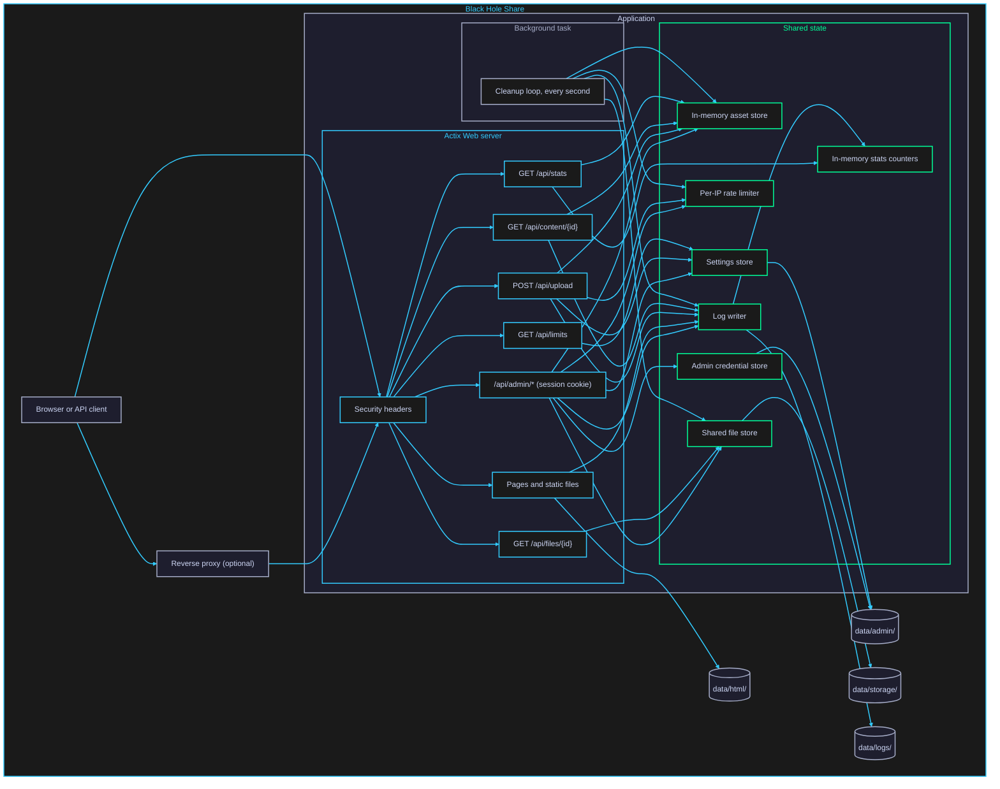

# Block Diagram

- The Actix Web server handles all HTTP traffic, including the pages and the API calls made by their JavaScript.
- The cleanup loop is a separate task that runs without any HTTP request.
- The web server and the cleanup loop use the same shared state.
- Assets, rate limits, and stats counters live only in memory and are lost on restart.
- `/api/stats` reads memory only. The log files are written but never read back.
- The client address comes from `X-Forwarded-For` only when the request arrives from a proxy listed in `trusted_proxies`.
- Settings are loaded from `data/admin/settings.json` at startup and changed through `/api/admin/settings`; uploads, the rate limiter, and the log writer read the current values.
- Shared files and their index live in `data/storage/`; the store reconciles the index with the directory at startup and the cleanup loop deletes expired files.
- Admin credentials, the session key, the settings, and the shared files are the state kept on disk besides logs; everything else is lost on restart.
