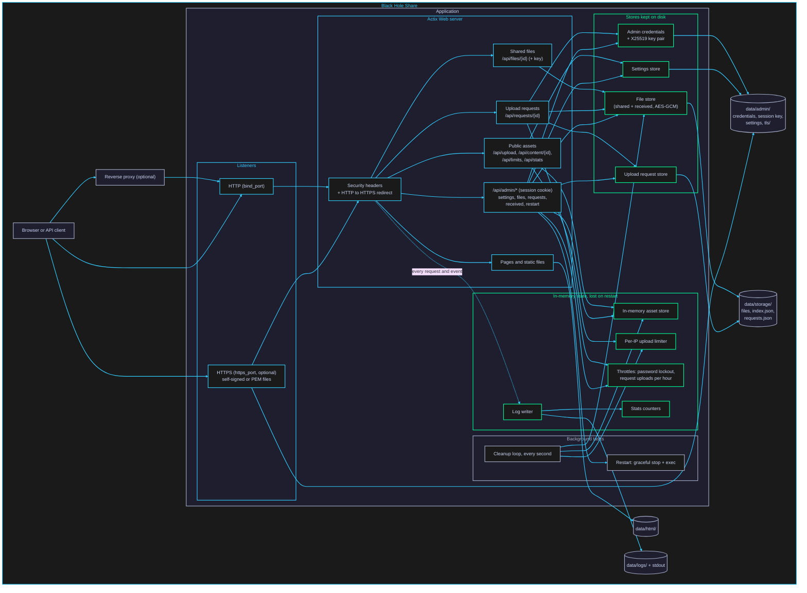

# Block Diagram

[README](../README.md) · [Configuration](configuration.md) · [Admin](admin.md) · [API](api.md) · [Architecture](architecture.md)

- The Actix Web server handles all HTTP traffic, including the pages and the API calls made by their JavaScript. Every route writes to the log writer, which also prints each event to standard output.
- HTTPS is optional and set at startup from the settings (`tls.rs`): off (the choice behind a TLS proxy), a self-signed certificate kept in `data/admin/tls/`, or PEM files. While it runs, plain HTTP is redirected to it with `308`; if it cannot start, the server serves plain HTTP only and the panel shows the error.
- The cleanup loop runs without any HTTP request and deletes expired assets and expired shared files.
- `POST /api/admin/restart` stops the server gracefully and replaces the process with a fresh start of the same binary (`exec`, same PID).
- Assets, upload limits, throttles, and stats counters live only in memory and are lost on restart. `/api/stats` reads memory only; the log files are written but never read back.
- The client address comes from `X-Forwarded-For` only when the request arrives from a proxy listed in `trusted_proxies`. Limits and throttles count an IPv6 client per /64.
- Settings are loaded from `data/admin/settings.json` at startup and changed through `/api/admin/settings`; uploads, limits, and the log writer read the current values.
- Shared files and their index live in `data/storage/`; the store reconciles the index with the directory at startup.
- Upload requests live in `data/storage/requests.json`. Files received through them are stored with the shared files, always encrypted for the admin, and excluded from every public route.
- Encrypted files are stored as AES-256-GCM chunks; their keys are wrapped for the admin's X25519 public key, whose private key in `data/admin/credentials.json` is protected by the admin password.
- Wrong admin passwords (login and every password prompt) and uploads to request links are limited per client by `throttle.rs`.
- On disk, besides the logs: admin credentials, the session key, the settings, and the self-signed certificate in `data/admin/`; shared and received files, their index, and the upload requests in `data/storage/`.
