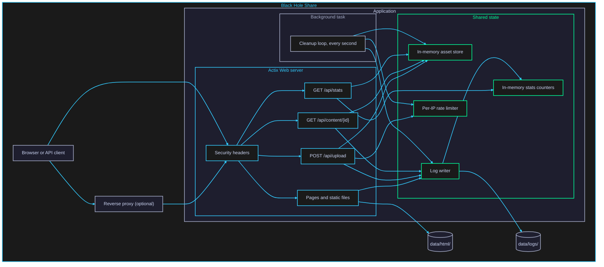

# Block Diagram

- The Actix Web server handles all HTTP traffic, including the pages and the API calls made by their JavaScript.
- The cleanup loop is a separate task that runs without any HTTP request.
- The web server and the cleanup loop use the same shared state.
- Assets, rate limits, and stats counters live only in memory and are lost on restart.
- `/api/stats` reads memory only. The log files are written but never read back.
- The client address comes from `X-Forwarded-For` only when the request arrives from a proxy in `TRUSTED_PROXIES`.
